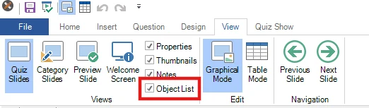
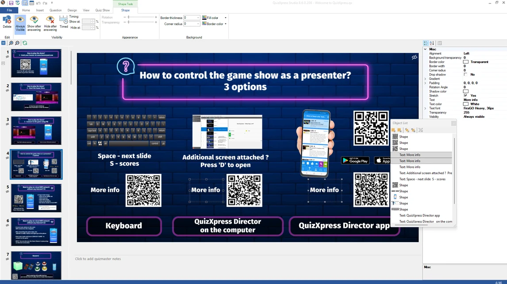

# Objectlijst-weergave

Het formulier Objectlijst kunt u aan- of uitzetten in het lint Weergave:

{ width="485" loading=lazy }

Wanneer dit hulpmiddel is ingeschakeld, verschijnt er een zwevend venster met een lijst van alle objecten op de huidige quizdia. Wanneer u een item in de lijst selecteert, wordt ook het visuele element op de dia geselecteerd (en andersom). U kunt meerdere items selecteren en items in de lijst slepen om hun Z-volgorde (de visuele volgorde van voor naar achter) te wijzigen. U kunt ook dubbelklikken op een regel in de lijst om de standaardactie ‘Bewerken’ voor het item uit te voeren. Om bijvoorbeeld de vraagtekst te bewerken, dubbelklikt u op het vraagitem in de lijst.

{ loading=lazy }
