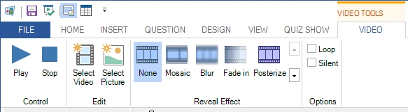

# Ruban

L’interface utilisateur de QuizXpress Studio est construite autour du concept de ruban. Le ruban a été introduit dans Microsoft Office et améliore considérablement la productivité des utilisateurs et la découvrabilité des fonctionnalités. Cliquez [ici](http://msdn.microsoft.com/en-us/library/windows/desktop/cc872782.aspx) pour plus d’informations générales sur le concept d’interface utilisateur à ruban de Microsoft.

Le ruban de QuizXpress Studio est divisé en plusieurs sections (onglets du ruban).

| **File**          | Également appelé menu « backstage ». Accès aux fonctionnalités globales et liées aux fichiers.      |
|-------------------|-------------------------------------------------------------------------------------------------|
| **Home**          | Éléments généraux de mise en forme et de contrôle                                                         |
| **Insert**        | Ajouter de nouveaux éléments tels que du son et du texte à votre diapositive de quiz                                      |
| **Question**      | Configurer le comportement d’une question (points, type de question, etc.)                           |
| **Design**        | Mettre en forme votre diapositive avec différents styles et mises en page                                               |
| **View**          | Choisir ce qui s’affiche dans l’interface utilisateur de QuizXpress Studio                                  |
| **Quiz Show**     | Lancer le quiz !                                                                            |
| **Picture**       | Configurer les images (affiché lors de la sélection d’une image sur une diapositive)                                  |
| **Shape**         | Configurer les formes d’images et de texte (affiché lors de la sélection d’une image ou d’un texte inséré sur une diapositive) |
| **Speech**        | Configurer la parole (affiché lors de la sélection d’un élément de parole sur une diapositive)                                  |
| **Chart**         | Configurer les graphiques (affiché lors de la sélection d’un graphique sur une diapositive)                                      |
| **Audio**         | Configurer un fragment audio (affiché lors de la sélection d’un élément audio sur une diapositive)                                  |
| **Video**         | Définir les diverses propriétés vidéo (affiché lors de la sélection d’une vidéo sur une diapositive)                      |
| **Trivia Board**  | Configurer une diapositive Trivia Board (onglet contextuel)                                                 |
| **Trivia Ladder** | Configurer une diapositive Trivia Ladder (onglet contextuel)                                                 |
| **Bingo**         | Configurer les propriétés d’une manche de Bingo                                                      |
| **Word Game**     | Configurer les propriétés d’un Word Game (onglet contextuel)                                       |
| **Trivia Feud**   | Configurer une diapositive Trivia Feud (onglet contextuel)                                                 |

En plus des onglets globaux du ruban toujours visibles, il existe des « onglets contextuels ». Leur visibilité dépend de l’élément sélectionné dans l’éditeur. Par exemple, lorsque vous sélectionnez un élément vidéo sur la diapositive, l’onglet contextuel VIDEO apparaît :

{ width="460" loading=lazy }

L’onglet disparaît dès que vous sélectionnez autre chose sur la diapositive.
