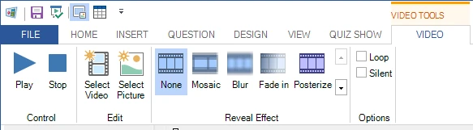

# Barra multifunzione

L’interfaccia utente di QuizXpress Studio è costruita attorno al concetto di barra multifunzione (ribbon). La barra multifunzione è stata introdotta in Microsoft Office e migliora notevolmente la produttività degli utenti e la scoperta delle funzionalità. Fare clic [qui](http://msdn.microsoft.com/en-us/library/windows/desktop/cc872782.aspx) per maggiori informazioni generali sul concetto di interfaccia utente a barra multifunzione di Microsoft.

La barra multifunzione di QuizXpress Studio è suddivisa in diverse sezioni (schede della barra).

| **File** | Chiamato anche menu ‘backstage’. Consente di accedere alle funzionalità globali e a quelle relative ai file. |
|-------------------|-------------------------------------------------------------------------------------------------|
| **Home** | Contiene gli elementi generali di formattazione e di controllo |
| **Inserisci** | Aggiunge nuovi elementi, come audio e testo, alla diapositiva del quiz |
| **Domanda** | Configura il comportamento della domanda (punti in palio, tipologia della domanda, ecc.) |
| **Design** | Personalizza la diapositiva con stili e layout diversi |
| **Vista** | Seleziona cosa visualizzare nell’interfaccia utente di QuizXpress Studio |
| **Quiz Show** | Avvia il quiz show, anche in modalità test |
| **Immagine** | Configura le immagini (visualizzata quando si seleziona un’immagine su una diapositiva) |
| **Forma** | Configura le forme di immagini e testo (visualizzata quando si seleziona un’immagine o un testo inserito su una diapositiva) |
| **Parlato** | Configura la sintesi vocale (visualizzata quando si seleziona un elemento parlato su una diapositiva) |
| **Grafico** | Configura i grafici (visualizzata quando si seleziona un grafico su una diapositiva) |
| **Audio** | Configura un frammento audio (visualizzata quando si seleziona un audio su una diapositiva) |
| **Video** | Imposta le varie proprietà del video (visualizzata quando si seleziona un video su una diapositiva) |
| **Tabellone Trivia** | Configura una diapositiva Tabellone Trivia (scheda contestuale) |
| **Trivia Ladder** | Configura una diapositiva Trivia Ladder (scheda contestuale) |
| **Bingo** | Configura le proprietà di un round di Bingo |
| **Word Game** | Configura le proprietà di un Word Game (scheda contestuale) |
| **Trivia Feud** | Configura una diapositiva Trivia Feud (scheda contestuale) |

Oltre alle schede globali della barra multifunzione, sempre visibili, esistono le cosiddette ‘schede contestuali’. La loro visibilità dipende dall’elemento selezionato nell’editor. Ad esempio, selezionando un elemento video sulla diapositiva, compare la scheda contestuale VIDEO:

{ width="460" loading=lazy }

La scheda scompare non appena si seleziona qualcos’altro sulla diapositiva.
