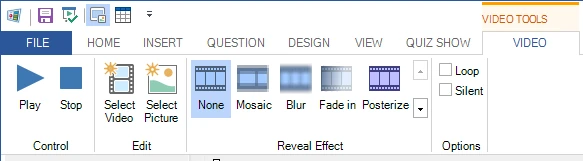

# Lint

De gebruikersinterface van QuizXpress Studio is opgebouwd rond het concept van een lint (ribbon). Het lint is geïntroduceerd in Microsoft Office en verhoogt de productiviteit van gebruikers en de vindbaarheid van functies aanzienlijk. Klik [hier](http://msdn.microsoft.com/en-us/library/windows/desktop/cc872782.aspx) voor meer algemene informatie over het gebruikersinterfaceconcept van het Microsoft-lint.

Het lint van QuizXpress Studio is verdeeld in meerdere secties (lint-tabbladen).

| **Bestand**       | Ook wel het ‘backstage’-menu genoemd. Toegang tot algemene en bestandsgerelateerde functies.                      |
|-------------------|-------------------------------------------------------------------------------------------------------------------|
| **Start**         | Algemene opmaak- en bedieningselementen                                                                           |
| **Invoegen**      | Voeg nieuwe elementen zoals geluid en tekst toe aan uw quizdia                                                    |
| **Vraag**         | Stel het gedrag van een vraag in (punten, type vraag, enz.)                                                       |
| **Ontwerp**       | Geef uw dia een opmaak in verschillende stijlen en indelingen                                                     |
| **Weergave**      | Kies wat u wilt zien in de gebruikersinterface van QuizXpress Studio                                              |
| **Quiz Show**     | Start de quizshow!                                                                                                |
| **Afbeelding**    | Stel afbeeldingen in (getoond wanneer u een afbeelding op een dia selecteert)                                     |
| **Vorm**          | Stel afbeeldings- en tekstvormen in (getoond wanneer u een ingevoegde afbeelding of tekst op een dia selecteert)  |
| **Spraak**        | Stel spraak in (getoond wanneer u een spraakelement op een dia selecteert)                                        |
| **Grafiek**       | Stel grafieken in (getoond wanneer u een grafiek op een dia selecteert)                                           |
| **Audio**         | Stel een audiofragment in (getoond wanneer u audio op een dia selecteert)                                         |
| **Video**         | Stel de diverse video-eigenschappen in (getoond wanneer u een video op een dia selecteert)                        |
| **Trivia Bord**   | Stel een Trivia Bord-dia in (contextueel tabblad)                                                                 |
| **Trivia Ladder** | Stel een Trivia Ladder-dia in (contextueel tabblad)                                                               |
| **Bingo**         | Stel de eigenschappen van een Bingo-ronde in                                                                      |
| **Woordspel**     | Stel de eigenschappen van een woordspel in (contextueel tabblad)                                                  |
| **Trivia Feud**   | Stel een Trivia Feud-dia in (contextueel tabblad)                                                                 |

Naast de algemene lint-tabbladen die altijd zichtbaar zijn, zijn er zogeheten ‘contextuele tabbladen’. Of ze zichtbaar zijn, hangt af van het geselecteerde item in de editor. Wanneer u bijvoorbeeld een video-item op de dia selecteert, verschijnt het contextuele tabblad VIDEO:

{ width="460" loading=lazy }

Het tabblad verdwijnt zodra u iets anders op de dia selecteert.
