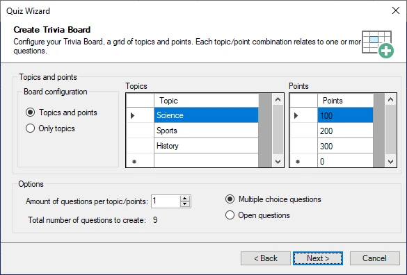

# El Quiz Wizard

Para ayudarle a crear contenido nuevo rápidamente, Studio también dispone de un Quiz Wizard. Para iniciarlo, en la pestaña HOME de la cinta de opciones, haga clic en el botón ‘Quiz Wizard’ de la sección ‘Magic’. El Quiz Wizard puede ayudarle a crear diapositivas individuales o rondas completas. Le guía a través de una serie de pasos, tras los cuales crea el contenido solicitado. Después solo tiene que rellenar las preguntas y respuestas reales en las diapositivas de quiz creadas. Por ejemplo, para crear un nuevo Trivia Board, el Wizard muestra la siguiente pantalla de configuración:

{ width="452" loading=lazy }

Aquí especifica el aspecto de la cuadrícula del Trivia Board y cuántas preguntas habrá por puntos o categoría.

Otro ejemplo del uso del Wizard es la posibilidad de generar una ronda completa de Disco Bingo a partir de una carpeta de archivos mp3. Leerá las etiquetas mp3 de artista y canción (cuando estén presentes en los archivos mp3) para generar automáticamente las respuestas correctas que aparecerán en los cartones de bingo.
