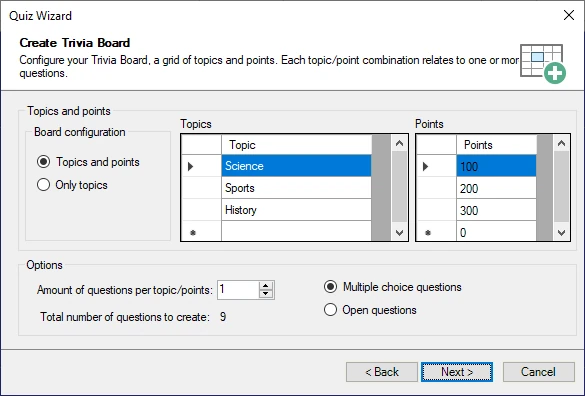

# Il Quiz Wizard

Per aiutare a creare rapidamente nuovi contenuti, Studio dispone anche di una procedura guidata, il Quiz Wizard. Per avviarlo, nella scheda HOME della barra multifunzione, fare clic sul pulsante ‘Quiz Wizard’ nella sezione ‘Procedure Guidate’. Il Quiz Wizard può aiutare a creare singole diapositive o interi round. Guida l’utente attraverso una serie di passaggi, al termine dei quali crea il contenuto richiesto. Non resta che inserire le domande e le risposte vere e proprie nelle diapositive del quiz create. Ad esempio, per creare un nuovo Tabellone Trivia, il Wizard mostra la seguente schermata di configurazione:

{ width="452" loading=lazy }

Qui è possibile specificare come sarà la griglia del Tabellone Trivia e quante domande per punti/argomento dovranno essere previste.

È anche possibile generare un intero round di Disco Bingo da una cartella di file mp3. Il Wizard userà i tag mp3 dell'artista/canzone (se presenti nei file mp3) per generare automaticamente le risposte corrette che appariranno sulle cartelle del Bingo.
