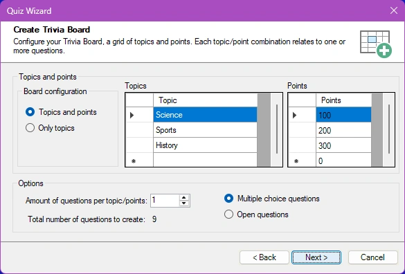

# De Quiz Wizard

Om u te helpen snel nieuwe inhoud te maken, heeft Studio ook een Quiz Wizard. Om deze te starten, klikt u op het tabblad START van het lint op de knop ‘Quiz Wizard’ in de sectie ‘Magie’. De Quiz Wizard kan u helpen bij het maken van afzonderlijke dia’s of complete rondes. Hij leidt u door een reeks stappen, waarna hij de gevraagde inhoud aanmaakt. U hoeft daarna alleen nog de eigenlijke vragen en antwoorden in te vullen op de aangemaakte quizdia’s. Om bijvoorbeeld een nieuw Trivia Bord te maken, toont de wizard het volgende configuratiescherm:

{ width="452" loading=lazy }

Hier geeft u op hoe het raster van het Trivia Bord eruit komt te zien en hoeveel vragen er per punten/categorie komen.

Een ander voorbeeld van het gebruik van de wizard is de mogelijkheid om een complete Disco Bingo-ronde te genereren uit een map met mp3-bestanden. De wizard leest de mp3-tags voor artiest en nummer (wanneer aanwezig in de mp3-bestanden) om automatisch de juiste antwoorden te genereren die op de bingokaarten verschijnen.
