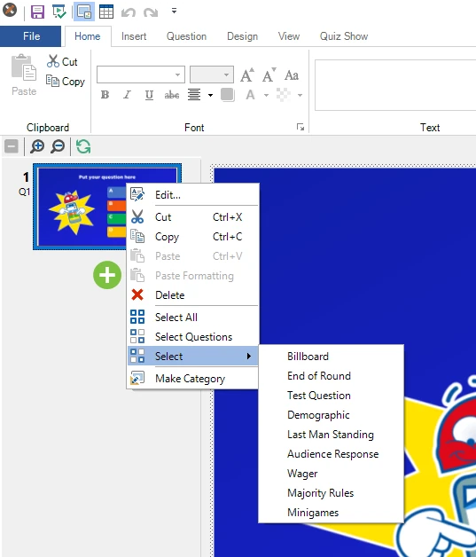
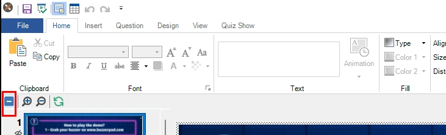
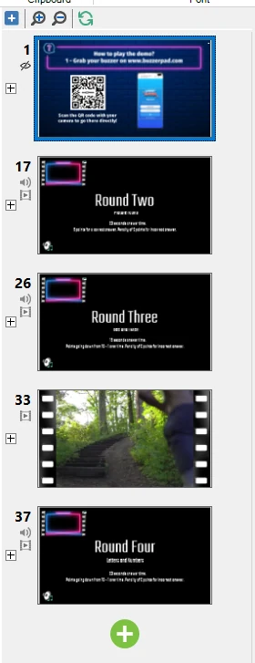
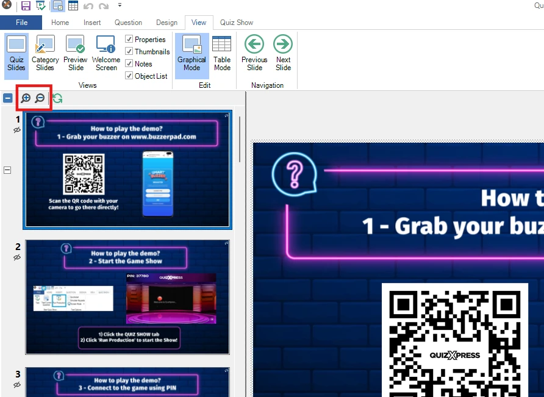

# Panel de miniaturas

Este panel le ofrece una vista general inmediata de todas sus preguntas. Puede ir a una pregunta haciendo clic en su miniatura, y mover una pregunta arrastrando su miniatura a una nueva posición y soltándola allí. El panel de miniaturas permite seleccionar varias preguntas haciendo clic en una miniatura mientras mantiene pulsada la tecla *Ctrl*, o utilizando el atajo *Ctrl+A* para seleccionar todas las preguntas del quiz. También puede seleccionar un intervalo de preguntas haciendo clic en la primera miniatura del intervalo y después en la última, mientras mantiene pulsada la tecla *Shift*. Cuando hay varias preguntas seleccionadas, puede cambiar las propiedades de todas ellas a la vez con la cuadrícula de propiedades (si no ve la cuadrícula de propiedades en el lado derecho de QuizXpress Studio, haga clic en VIEW en la cinta de opciones y marque la casilla ‘Properties’). Esto también permite eliminar varias diapositivas de quiz a la vez.

El panel de miniaturas tiene un menú contextual. Haga clic con el botón derecho en el panel de miniaturas para abrir este menú:

{ width="228" loading=lazy }

Desde aquí puede copiar, pegar o eliminar una o varias preguntas seleccionadas, seleccionar todas las diapositivas, seleccionar todas las preguntas (los banners se excluyen de la selección al usar ‘Select Questions’) o seleccionar todas las diapositivas de un tipo concreto. Tenga en cuenta que también puede copiar y pegar diapositivas de quiz entre dos instancias de Studio, lo que le permite crear ‘bibliotecas’ de preguntas a partir de las cuales construir sus quizzes específicos.

En el cuadro de diálogo Options (que puede abrir desde la pestaña HOME > botón Options), puede activar que el panel de miniaturas muestre información adicional de cada diapositiva, como el número real de la pregunta (tal como se muestra en QuizXpress Live). Encontrará esta opción en la pestaña ‘Other’ del cuadro de diálogo Options:

**Contraer/expandir rondas**

Puede contraer o expandir la lista de miniaturas al nivel de rondas para ver rápidamente la estructura del quiz cargado. Esto resulta útil cuando un quiz tiene muchas diapositivas y rondas. En la parte superior del panel hay una barra de herramientas con una herramienta **\[-\]** **Collapse All** / **\[+\]** **Expand All**. Al hacer clic en **Collapse All**, la lista se contrae al nivel de ronda:

{ width="602" loading=lazy }

Después verá solo el inicio de cada ronda del quiz (una ronda comienza en la primera diapositiva posterior a una o más diapositivas de fin de ronda):

{ width="187" loading=lazy }

Al hacer clic en \[+\] a la izquierda de la diapositiva de ronda, las diapositivas de esa ronda vuelven a aparecer. En la barra de herramientas, puede hacer clic en \[+\] para expandir todas las rondas. Cuando su quiz no tiene rondas, no verá \[+\] ni \[-\] junto a las diapositivas, y el control de la barra de herramientas estará desactivado.

**Ampliar miniaturas**

Si prefiere las miniaturas un poco más grandes, puede acercar o alejar con las herramientas de zoom:

{ width="591" loading=lazy }

*Tenga en cuenta que, al hacer zoom, la lista de miniaturas se vuelve a dibujar por completo con el nuevo tamaño (acercar requiere más detalle, lo que implica volver a renderizar), lo que puede tardar un poco según el tamaño del quiz.*
