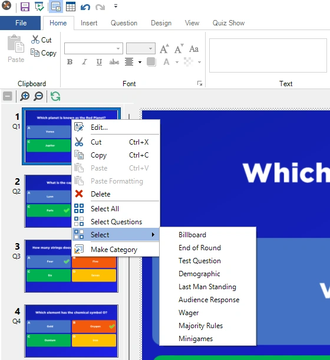
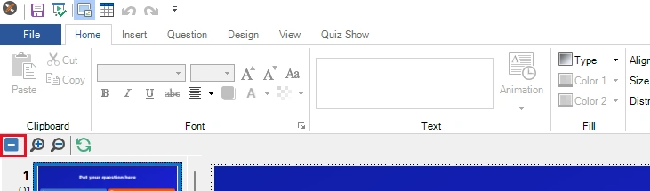
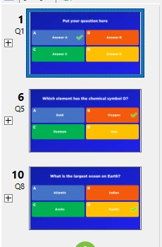
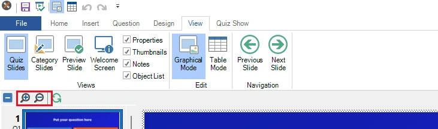

# Miniaturenpaneel

Dit paneel geeft u een directe indruk van al uw vragen. U navigeert naar een vraag door op een miniatuur te klikken en verplaatst een vraag door de miniatuur naar een nieuwe positie te slepen en daar neer te zetten. Met het miniaturenpaneel kunt u meerdere vragen selecteren door op een miniatuur te klikken terwijl u de toets *Ctrl* ingedrukt houdt, of met de sneltoets *Ctrl+A* om alle vragen in de quiz te selecteren. U kunt ook een reeks vragen selecteren door op de eerste miniatuur van de reeks te klikken en daarna, met de toets *Shift* ingedrukt, op de laatste miniatuur. Wanneer meerdere vragen zijn geselecteerd, kunt u de eigenschappen van alle vragen tegelijk wijzigen met het eigenschappenraster (als u het eigenschappenraster niet aan de rechterkant van QuizXpress Studio ziet, klikt u op BEELD in het lint en plaatst u een vinkje voor ‘Eigenschappen’). Zo kunt u ook meerdere quizdia’s in één keer verwijderen.

Het miniaturenpaneel heeft een contextmenu. Klik met de rechtermuisknop op het miniaturenpaneel om dit menu te openen:

{ width="300" loading=lazy }

Hier kunt u een of meer geselecteerde vragen kopiëren, plakken of verwijderen, alle dia’s selecteren, alle vragen selecteren (banners worden uitgesloten van de selectie bij gebruik van ‘Selecteer vragen’) of alle dia’s van een bepaald type selecteren. Let op: u kunt quizdia’s ook kopiëren en plakken tussen twee exemplaren van Studio, zodat u ‘bibliotheken’ met vragen kunt maken waaruit u uw specifieke quizzen samenstelt.

In het dialoogvenster Opties (dat u opent via het tabblad START > knop Opties) kunt u instellen dat het miniaturenpaneel extra informatie per dia toont, zoals het werkelijke vraagnummer (zoals getoond in QuizXpress Live). U vindt deze optie op het tabblad ‘Overig’ van het dialoogvenster Opties.

**Rondes samenvouwen/uitvouwen**

U kunt de lijst met miniaturen op rondeniveau samenvouwen of uitvouwen om snel de structuur van de geladen quiz te zien. Dit is handig wanneer een quiz veel dia’s en rondes bevat. Boven in het paneel staat een werkbalk met een hulpmiddel **\[-\]** **Alles samenvouwen** / **\[+\]** **Alles uitvouwen**. Als u op **Alles samenvouwen** klikt, wordt de lijst samengevouwen tot rondeniveau:

{ loading=lazy }

Daarna ziet u alleen het begin van elke ronde in de quiz (een ronde begint bij de eerste dia na een of meer einde-ronde-dia’s):

{ loading=lazy }

Door links van de rondedia op \[+\] te klikken, verschijnen de dia’s van die ronde weer. In de werkbalk kunt u op \[+\] klikken om alle rondes uit te vouwen. Wanneer uw quiz geen rondes bevat, ziet u geen \[+\] of \[-\] naast de dia’s en is het element in de werkbalk uitgeschakeld.

**Miniaturen zoomen**

Als u de miniaturen liever iets groter hebt, kunt u in- en uitzoomen met de zoomhulpmiddelen:

{ loading=lazy }

*Let op: wanneer u zoomt, wordt de lijst met miniaturen volledig opnieuw getekend op het nieuwe formaat (inzoomen vraagt meer detail, wat een nieuwe weergave vereist), wat even kan duren afhankelijk van de grootte van de quiz.*
