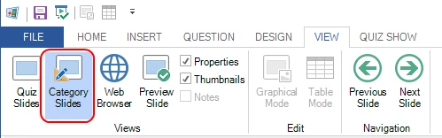
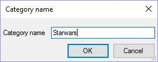
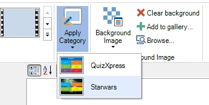

# Usare le categorie

Le categorie consentono di dare lo stesso aspetto a gruppi di domande. Ad esempio, in un quiz potrebbero esserci domande di scienze, musica, cinema, ecc. Per far sì che tutte le domande di scienze abbiano lo stesso aspetto, è possibile creare una categoria chiamata ‘Science’. Per questa categoria si possono poi impostare proprietà come l’immagine di sfondo, il carattere e i colori. Quando si crea una nuova domanda di scienze, è possibile applicare la categoria ‘Science’ e l’intera domanda verrà formattata secondo il modello ‘Science’. Tutte le categorie sono memorizzate nel file del quiz corrente. Se si usano spesso le stesse categorie, consigliamo di creare un file di quiz vuoto da usare come punto di partenza per tutti i quiz. Le categorie svolgono un ruolo importante anche nell’importazione di domande direttamente da Excel: poiché le informazioni di formattazione avanzata non possono essere memorizzate in Excel, ogni domanda in Excel può invece fare riferimento a una categoria esistente da cui verrà applicata la formattazione alla diapositiva appena creata. Per creare una nuova categoria, passare prima alla vista ‘Category’:

{ width="407" loading=lazy }

Quindi attivare la scheda INSERT della barra multifunzione, fare clic su uno dei modelli e inserire un nome per la categoria:

{ width="220" loading=lazy }

Ora è possibile impostare le proprietà della categoria, come lo sfondo da usare. Per applicare una categoria, tornare alla vista normale delle diapositive del quiz, selezionare una o più diapositive nel pannello delle miniature a sinistra, attivare la scheda DESIGN e scegliere la categoria dalla galleria Categories:

{ width="350" loading=lazy }

Le diapositive selezionate verranno così formattate come la diapositiva della categoria.

## Video di sfondo per una categoria

Una categoria può avere anche un [video di sfondo](backgrounds.md#video-di-sfondo), ad esempio un’animazione in loop nei colori del round ‘Science’. Selezionare la diapositiva della categoria nella vista Category e impostarlo come per una diapositiva normale: fare clic con il tasto destro sul suo sfondo e scegliere ‘Background video…’, oppure impostare la proprietà ‘Background video’ nel riquadro delle proprietà, insieme alle relative impostazioni (loop, silent, sync with quiz).

Quando si applica la categoria, ogni diapositiva selezionata riceve il video di sfondo con le stesse impostazioni. Il video viene memorizzato una sola volta nel file del quiz, indipendentemente dal numero di diapositive che lo usano. Un’immagine o un video nei segnaposto di quelle diapositive rimane dov’è e viene riprodotto sopra il video di sfondo. Applicare di nuovo la categoria, o un’altra categoria con un video di sfondo, sostituisce il video di sfondo della diapositiva. In seguito è comunque possibile modificare le impostazioni del video di sfondo per ogni singola diapositiva.

Le domande importate da Excel che fanno riferimento alla categoria ricevono anch’esse il suo video di sfondo, a meno che la colonna BACKGROUND-VIDEO della domanda indichi un video proprio (vedere [Import and export of questions](import-and-export-of-questions.md)).
