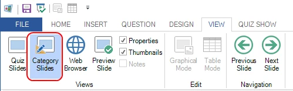
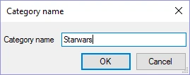
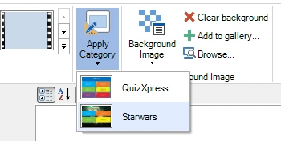

# Categorieën gebruiken

Met categorieën laat u groepen vragen er hetzelfde uitzien. In één quiz kunt u bijvoorbeeld vragen hebben over wetenschap, muziek, films enzovoort. Om alle vragen over wetenschap er hetzelfde uit te laten zien, kunt u een categorie ‘Wetenschap’ maken. Voor deze categorie kunt u dan eigenschappen instellen zoals de achtergrondafbeelding, het lettertype en de kleuren. Wanneer u een nieuwe vraag over wetenschap maakt, kunt u de categorie ‘Wetenschap’ toepassen, en de hele vraag wordt opgemaakt volgens het sjabloon ‘Wetenschap’. Alle categorieën worden opgeslagen in uw huidige quizbestand. Als u regelmatig dezelfde categorieën gebruikt, raden wij aan een leeg quizbestand te maken dat u als uitgangspunt voor al uw quizzen gebruikt. Categorieën spelen ook een belangrijke rol bij het rechtstreeks importeren van vragen uit Excel: omdat geavanceerde opmaakinformatie niet in Excel kan worden opgeslagen, kan elke vraag in Excel in plaats daarvan verwijzen naar een bestaande categorie waaruit de opmaak wordt toegepast op de nieuw gemaakte dia. Om een nieuwe categorie te maken, schakelt u eerst over naar de weergave ‘Categorie’:

{ width="407" loading=lazy }

Activeer vervolgens het lint-tabblad INVOEGEN, klik op een van de sjablonen en voer een naam in voor uw categorie:

{ width="220" loading=lazy }

Nu kunt u de eigenschappen van de categorie instellen, zoals de te gebruiken achtergrond. Om een categorie toe te passen, schakelt u terug naar de normale weergave met quizdia’s, selecteert u links in het miniaturenpaneel een of meer dia’s, activeert u het tabblad ONTWERP en kiest u de categorie in de galerij Categorieën:

{ width="350" loading=lazy }

Nu worden de geselecteerde dia’s opgemaakt zoals de categoriedia.

## Achtergrondvideo voor een categorie

Een categorie kan ook een [achtergrondvideo](backgrounds.md#achtergrondvideo) hebben, bijvoorbeeld een zich herhalende animatie in de kleuren van de ronde ‘Wetenschap’. Selecteer de categoriedia in de weergave Categorie en stel deze in op dezelfde manier als bij een gewone dia: klik met de rechtermuisknop op de achtergrond en kies ‘Achtergrondvideo…’, of stel de eigenschap ‘Achtergrondvideo’ in het eigenschappenvenster in, samen met de bijbehorende instellingen (herhalen, geluidloos, synchroon met quiz).

Wanneer u de categorie toepast, krijgt elke geselecteerde dia de achtergrondvideo met dezelfde instellingen. De video wordt slechts één keer in het quizbestand opgeslagen, hoeveel dia’s hem ook gebruiken. Een afbeelding of video in de plaatshouders van die dia’s blijft staan waar hij staat en wordt boven op de achtergrondvideo afgespeeld. Als u de categorie opnieuw toepast, of een andere categorie met een achtergrondvideo, wordt de achtergrondvideo van de dia vervangen. Daarna kunt u de instellingen van de achtergrondvideo nog steeds per dia wijzigen.

Vragen die uit Excel zijn geïmporteerd en naar de categorie verwijzen, krijgen ook de achtergrondvideo ervan, tenzij de kolom BACKGROUND-VIDEO van de vraag een eigen video noemt (zie [Import en export van vragen](import-and-export-of-questions.md)).
